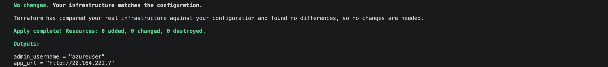
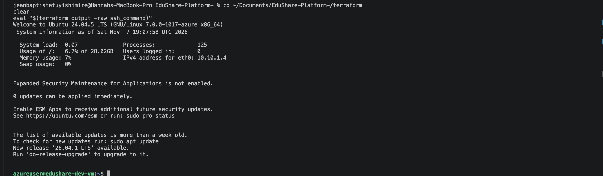
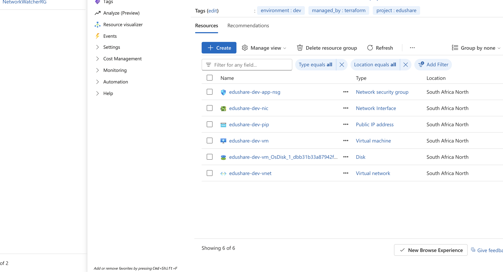

# EduShare infrastructure (Terraform, Azure)

This folder provisions everything EduShare needs to run on Azure: a virtual network, a firewall (network security group) and one Ubuntu 24.04 VM. Ansible (`../ansible`) then installs Docker on that VM and deploys the app.

## What gets created

```
Resource group  edushare-dev-rg
├── Virtual network  edushare-dev-vnet        10.10.0.0/16
│   └── Subnet       edushare-dev-app-subnet  10.10.1.0/24
│       └── NSG      edushare-dev-app-nsg
│             allow 22/tcp  from allowed_ssh_cidrs only
│             allow 80/tcp  from Internet
│             deny  everything else (Azure default)
├── Public IP        edushare-dev-pip         static, Standard SKU
├── NIC              edushare-dev-nic
└── VM               edushare-dev-vm          Ubuntu 24.04, SSH keys only
```

`terraform plan` on an empty subscription shows **8 to add**.

## Layout

```
terraform/
├── versions.tf               Terraform + provider versions, provider config
├── variables.tf              all inputs, with validation rules
├── main.tf                   resource group + calls the two modules
├── outputs.tf                IPs, resource IDs, ready-made SSH command
├── terraform.tfvars.example  copy to terraform.tfvars and fill in
└── modules/
    ├── network/              VNet, subnet, NSG (+ subnet association)
    └── compute/              public IP, NIC, Linux VM
```

Splitting network and compute into modules means each piece has a clear interface (its `variables.tf` and `outputs.tf`). The root module only connects them: the network module's `subnet_id` output becomes the compute module's `subnet_id` input.

## Prerequisites

- Terraform 1.6 or newer (`terraform version`)
- Azure CLI, logged in (`az login`)
- An SSH key pair. If you don't have one:
  ```bash
  ssh-keygen -t rsa -b 4096 -f ~/.ssh/alu-devops -N ""
  ```

## Usage

```bash
cd terraform

# 1. Tell the Azure provider which subscription to use (never hardcoded)
export ARM_SUBSCRIPTION_ID=$(az account show --query id -o tsv)

# 2. Your settings: region, your IP, your public key
cp terraform.tfvars.example terraform.tfvars
curl -s ifconfig.me          # put this IP + /32 in allowed_ssh_cidrs

# 3. Download the provider and set up the working folder
terraform init

# 4. Preview the changes (expect 8 to add on first run)
terraform plan -out=tfplan

# 5. Create the infrastructure
terraform apply tfplan

# 6. See the outputs again at any time
terraform output
terraform output -raw vm_public_ip
```

Log in to check the VM: `eval "$(terraform output -raw ssh_command)"`.

When you are done, delete everything so it stops using credit:

```bash
terraform destroy
```

## Inputs

| Variable | Default | Description |
|---|---|---|
| `location` | (required) | Azure region, e.g. `southafricanorth` |
| `allowed_ssh_cidrs` | (required) | IPs allowed to SSH, e.g. `["41.186.205.191/32"]`. `0.0.0.0/0` is rejected |
| `project` | `edushare` | Prefix for all resource names |
| `environment` | `dev` | `dev`, `staging` or `prod` |
| `vm_size` | `Standard_B2als_v2` | VM size (2 vCPU, 4 GB RAM). B2s is blocked for student subscriptions in several regions |
| `admin_username` | `azureuser` | Linux user Ansible connects as |
| `ssh_public_key_paths` | `["~/.ssh/alu-devops.pub"]` | One public key per teammate |
| `os_disk_size_gb` | `30` | 30 to 128 |
| `vnet_address_space` | `["10.10.0.0/16"]` | VNet range |
| `subnet_address_prefix` | `10.10.1.0/24` | Subnet range |
| `app_port` | `80` | Public website port |
| `tags` | `{}` | Extra tags for every resource |

## Outputs

| Output | Used for |
|---|---|
| `vm_public_ip` | Ansible inventory, browser |
| `admin_username` | Ansible `ansible_user` |
| `ssh_command` | Logging in by hand |
| `app_url` | Opening the site after Ansible runs |
| `resource_group_id`, `vnet_id`, `subnet_id`, `nsg_id`, `vm_id` | Referencing resources elsewhere (portal, CLI, other configs) |
| `resource_group_name`, `vm_private_ip` | Azure CLI commands, debugging |

## Security choices

- **No secrets in code.** The subscription ID comes from `ARM_SUBSCRIPTION_ID`; IPs live in the git-ignored `terraform.tfvars`.
- **SSH locked down.** Port 22 is only open to the IPs in `allowed_ssh_cidrs`, and the validation rule rejects `0.0.0.0/0`.
- **Keys only.** `disable_password_authentication = true`, with one public key per teammate. Nobody shares private keys.
- **No VM extensions.** `allow_extension_operations = false`, since Ansible does the configuration.
- **Deny by default.** Only ports 22 and 80 are opened. Everything else hits Azure's built-in `DenyAllInbound` rule. MongoDB (27017) is never exposed.
- **State stays local and ignored.** `*.tfstate` holds resource details and is in `.gitignore`.

## Evidence

Deployed to `southafricanorth` on 7 Nov 2026.

**`terraform plan`** on an empty subscription:

```
  # azurerm_resource_group.main will be created
  # module.compute.azurerm_linux_virtual_machine.vm will be created
  # module.compute.azurerm_network_interface.vm will be created
  # module.compute.azurerm_public_ip.vm will be created
  # module.network.azurerm_network_security_group.app will be created
  # module.network.azurerm_subnet.app will be created
  # module.network.azurerm_subnet_network_security_group_association.app will be created
  # module.network.azurerm_virtual_network.main will be created
Plan: 8 to add, 0 to change, 0 to destroy.
```

**`terraform output`** after apply (subscription ID replaced with `<sub>`):

```
admin_username      = "azureuser"
app_url             = "http://20.164.222.7"
resource_group_name = "edushare-dev-rg"
ssh_command         = "ssh -i ~/.ssh/alu-devops azureuser@20.164.222.7"
vm_private_ip       = "10.10.1.4"
vm_public_ip        = "20.164.222.7"
vm_id               = "/subscriptions/<sub>/resourceGroups/edushare-dev-rg/providers/Microsoft.Compute/virtualMachines/edushare-dev-vm"
```

**Checkov** (`checkov -d terraform --framework terraform`): 14 passed, 0 failed, 1 skipped (`CKV_AZURE_119`, documented accepted risk).

**Screenshots:**

| | |
|---|---|
| `terraform apply` complete |  |
| SSH login to the VM |  |
| Resource group in the Azure portal |  |

## Troubleshooting

| Error | Fix |
|---|---|
| `SkuNotAvailable ... Capacity Restrictions` | That size is sold out in the region. Try another size, e.g. `-var vm_size=Standard_B2s_v2`. List what your subscription may use: `az vm list-skus -l southafricanorth --size Standard_B2 -o table` (rows with restrictions are blocked) |
| `subscription ID could not be determined` | Run the `export ARM_SUBSCRIPTION_ID=...` line again (new terminals forget it) |
| `Too many command line arguments` | zsh does not treat `#` as a comment. Don't paste the comments, or run `setopt interactivecomments` |
| SSH times out | Your IP changed. Update `allowed_ssh_cidrs` and run `terraform apply` again |
| `Currently selected workspace "..." does not exist` | An old `TF_WORKSPACE` variable is set: `unset TF_WORKSPACE TF_CLOUD_ORGANIZATION` |
